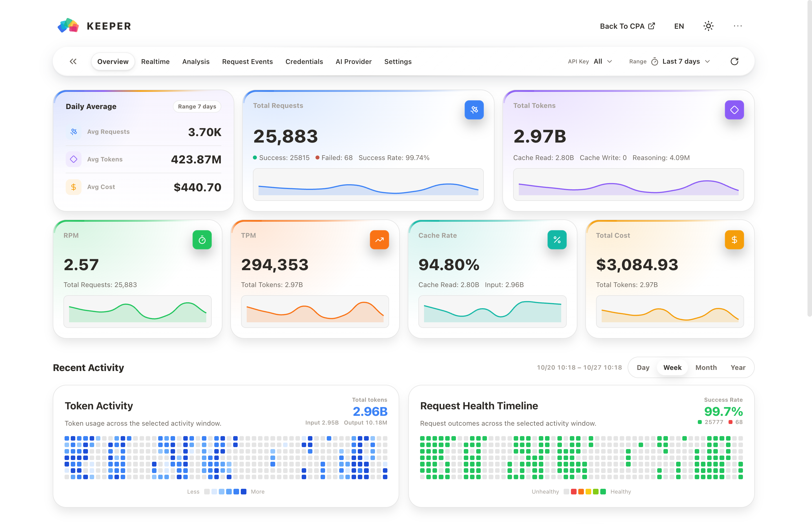
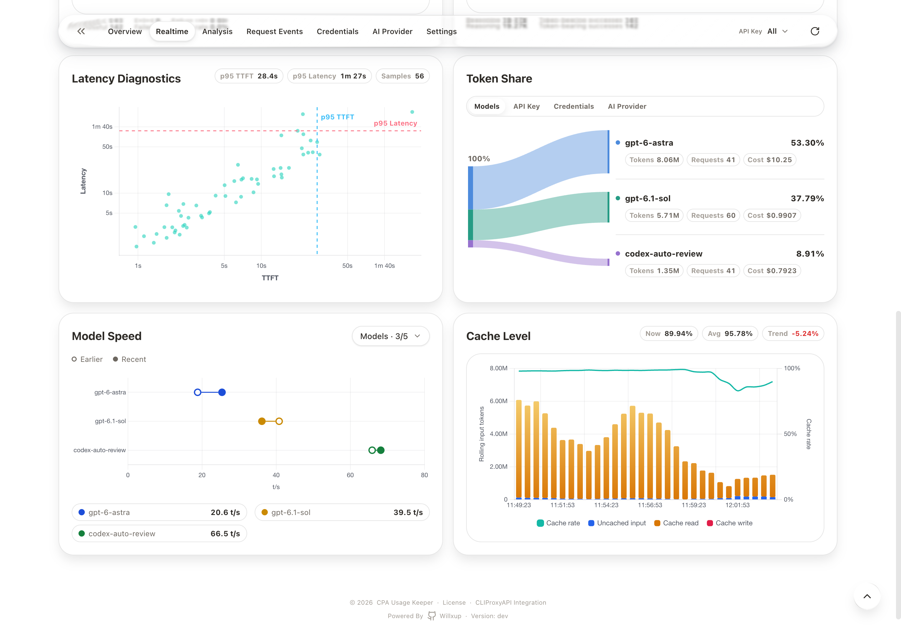
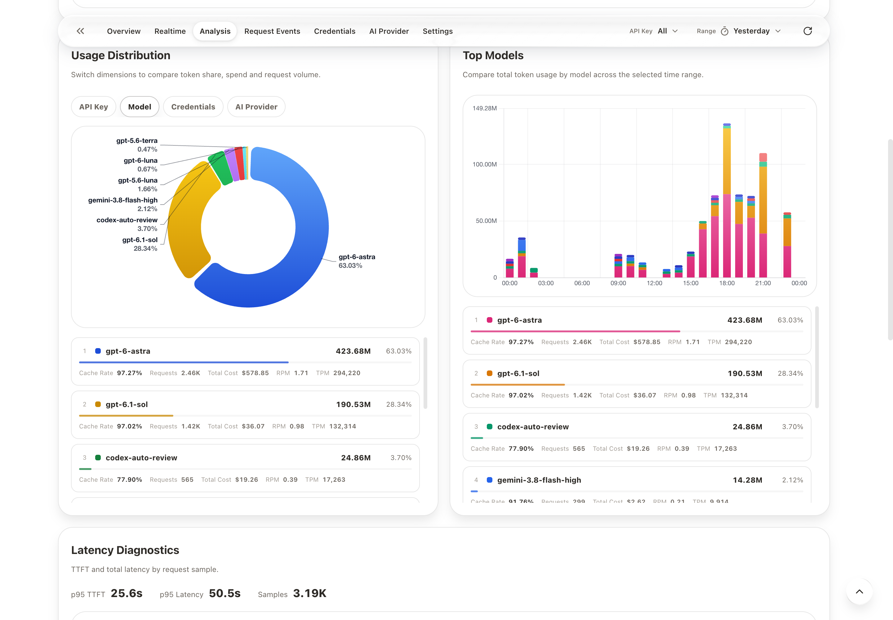
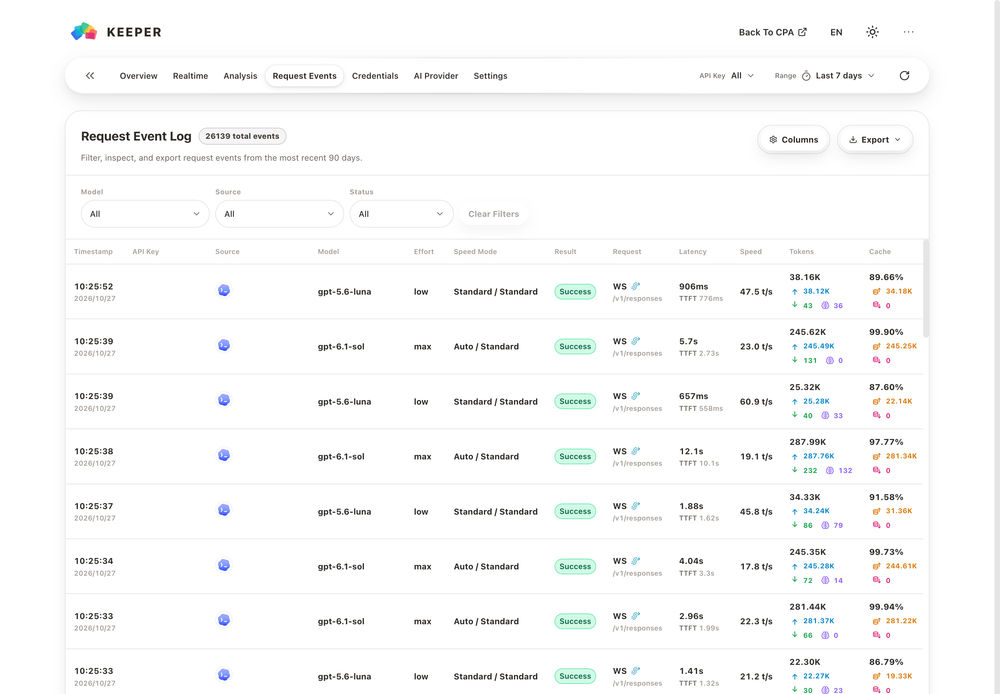
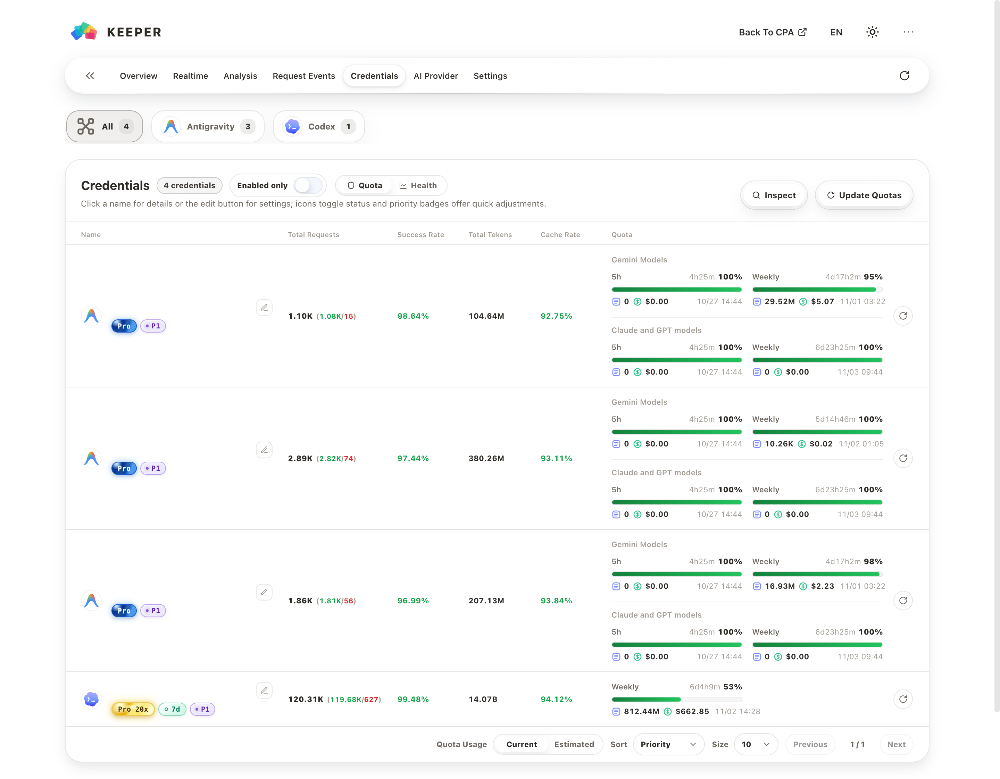
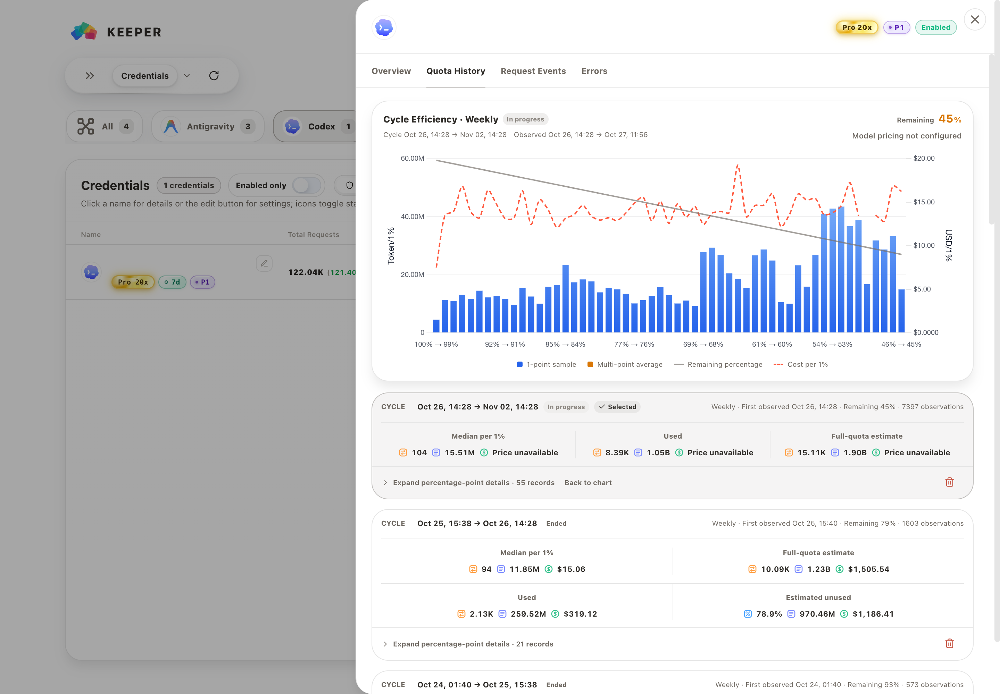

<p align="center">
  <picture>
    <source media="(prefers-color-scheme: dark)" srcset="./assets/keeper-logo-dark.svg" />
    <source media="(prefers-color-scheme: light)" srcset="./assets/keeper-logo-light.svg" />
    
  </picture>
</p>

<p align="center">
  <a href="./README.md">English</a> ｜ <a href="./README.zh.md"><strong>简体中文</strong></a>
</p>

<h1 align="center">CPA Usage Keeper</h1>

<p align="center">万千流转，皆有迹可循。</p>

<p align="center">
  <a href="https://github.com/Willxup/cpa-usage-keeper/releases/latest"></a>
  <a href="https://github.com/Willxup/cpa-usage-keeper/actions/workflows/ci.yml"></a>
  <a href="https://github.com/Willxup/cpa-usage-keeper/pkgs/container/cpa-usage-keeper"></a>
  <a href="https://github.com/Willxup/homebrew-cpa-usage-keeper"></a>
  <a href="https://github.com/Willxup/cpa-usage-keeper/releases/latest"></a>
  <a href="https://github.com/Willxup/cpa-usage-keeper/releases/latest"></a>
  <a href="https://github.com/Willxup/cpa-usage-keeper/releases/latest"></a>
  <a href="./LICENSE"></a>
</p>

为 [CLIProxyAPI（CPA）](https://github.com/router-for-me/CLIProxyAPI) 保存用量历史，看清模型花费、请求表现和凭证限额。CPA Usage Keeper 将总览、实时诊断、请求明细与限额历史集中在一个独立部署的面板中。

<p align="center">
  <strong><a href="#keeper-only">部署 Keeper</a>&emsp;|&emsp;<a href="#cpa--keeper">部署 CPA + Keeper</a>&emsp;|&emsp;<a href="#配置">查看配置</a></strong>
</p>

## 界面预览

<table>
  <tr>
    <td width="50%" align="center">
      <strong>总览</strong>
      <picture>
        <source media="(prefers-color-scheme: dark)" srcset="./assets/screenshots/overview-dark.png" />
        <source media="(prefers-color-scheme: light)" srcset="./assets/screenshots/overview-white.png" />
        
      </picture>
    </td>
    <td width="50%" align="center">
      <strong>实时诊断</strong>
      <picture>
        <source media="(prefers-color-scheme: dark)" srcset="./assets/screenshots/realtime-dark.png" />
        <source media="(prefers-color-scheme: light)" srcset="./assets/screenshots/realtime-white.png" />
        
      </picture>
    </td>
  </tr>
  <tr>
    <td width="50%" align="center">
      <strong>用量分析</strong>
      <picture>
        <source media="(prefers-color-scheme: dark)" srcset="./assets/screenshots/analysis-dark.png" />
        <source media="(prefers-color-scheme: light)" srcset="./assets/screenshots/analysis-white.png" />
        
      </picture>
    </td>
    <td width="50%" align="center">
      <strong>请求事件</strong>
      <picture>
        <source media="(prefers-color-scheme: dark)" srcset="./assets/screenshots/request-events-dark.png" />
        <source media="(prefers-color-scheme: light)" srcset="./assets/screenshots/request-events-white.png" />
        
      </picture>
    </td>
  </tr>
  <tr>
    <td width="50%" align="center">
      <strong>凭证与限额</strong>
      <picture>
        <source media="(prefers-color-scheme: dark)" srcset="./assets/screenshots/credentials-dark.png" />
        <source media="(prefers-color-scheme: light)" srcset="./assets/screenshots/credentials-white.png" />
        
      </picture>
    </td>
    <td width="50%" align="center">
      <strong>限额历史</strong>
      <picture>
        <source media="(prefers-color-scheme: dark)" srcset="./assets/screenshots/quota-history-dark.png" />
        <source media="(prefers-color-scheme: light)" srcset="./assets/screenshots/quota-history-white.png" />
        
      </picture>
    </td>
  </tr>
</table>

## 功能特性

- **保留历史**：持续保存 CPA 用量到 SQLite，并支持定时备份。
- **看清花费**：按模型、API Key 和提供商分析用量、缓存及估算成本。
- **定位问题**：查看和导出请求明细，通过成功率、首字延迟（TTFT）和总耗时分析请求表现。
- **掌握额度**：查看凭证健康与剩余限额，支持限额刷新、优先级编辑和 Codex 限额历史。
- **按需分享**：为单个 CPA API Key 提供独立的只读用量视图。

此外，还支持通过 CPA 插件嵌入 CPAMC。可使用 Docker Compose、Homebrew 或二进制部署，登录保护默认开启。

## 赞助与特别感谢

- 感谢 [CLIProxyAPI（CPA）](https://github.com/router-for-me/CLIProxyAPI) 提供本项目所依赖的上游 CPA 基础与数据来源。
- 感谢 [@YouShouldBetOnMe](https://github.com/YouShouldBetOnMe) 对 CPA Usage Keeper 的支持。
- 感谢 CPA 讨论组（QQ群组）的讨论与反馈。

## 快速开始

> Keeper 支持 CPA v8.0.12+。请将 `observability.usage.usage-statistics-enabled` 设为 `true`，开启使用统计。<br>
> 同一 CPA 接入多个采集服务时，须全部使用订阅模式，避免收数中断或数据缺失。

推荐使用 Docker Compose，无需安装 Go、Node.js 或编译源码。按下表选择部署方式；已有 CPA 时，准备好 CPA 地址、管理密钥和 Keeper 登录密码。

| 场景 | 推荐方式 | 架构 |
| --- | --- | --- |
| 首次部署 CPA + Keeper | [Docker Compose：CPA + Keeper](#cpa--keeper) | `linux/amd64`、`linux/arm64` |
| 已有 CPA | [Docker Compose：仅 Keeper](#keeper-only) | `linux/amd64`、`linux/arm64` |
| 已有 CPA，偏好 Docker CLI | [Docker](#dockercpa-已在宿主机运行) | `linux/amd64`、`linux/arm64` |
| macOS | [Homebrew](#macos-homebrew) | `amd64`、`arm64` |
| Linux 不使用容器 | [Linux 二进制](#linux-二进制) | `amd64`、`arm64` |
| Windows | [Windows Binary](#windows-binary) | `amd64`、`arm64` |

登录保护默认启用。启动 Keeper 前请配置 `LOGIN_PASSWORD`；只有部署环境已可靠隔离访问时，才显式设置 `AUTH_ENABLED=false`。

## Benchmark

`linux/amd64` 生产型容量测试覆盖持续 ingestion、Dashboard 延迟、CPU 利用率和 Keeper cgroup 峰值内存，完整结果见 [容量 Benchmark 报告](./internal/benchmark/reports/capacity/README.zh.md)。

## 开发者参考

<details>
<summary>项目结构、本地运行与测试</summary>

### 项目结构

```text
cmd/server/              应用入口
internal/api/            HTTP 路由与处理器
internal/app/            应用装配与启动
internal/auth/           Session 与访问控制
internal/poller/         CPA 用量与配置同步
internal/repository/     SQLite 持久化与聚合
internal/service/        用量、定价与身份服务
internal/quota/          Provider 限额刷新与巡检
internal/benchmark/      容量套件、报告、manifest 与历史 Go microbenchmark
deploy/                  部署模板
web/                     React + TypeScript 前端
```

### 本地开发

#### 前置依赖

- Go 1.26.10+
- Node.js 24.22.1+
- npm
- 一个可用的 [CLIProxyAPI（CPA）](https://github.com/router-for-me/CLIProxyAPI) 实例

使用 nvm 时，在仓库根目录运行 `nvm install` 和 `nvm use`，即可选择 `.nvmrc` 中指定的版本。

#### 本地运行

1. 将 `.env.example` 复制为 `.env`，至少设置 `CPA_BASE_URL`、`CPA_MANAGEMENT_KEY` 和私有的 `LOGIN_PASSWORD`。

```bash
cp .env.example .env
vim .env
```

2. 启动后端。

```bash
go run ./cmd/server/main.go
```

3. 在另一个终端安装前端依赖并启动开发服务器。

```bash
npm --prefix ./web ci
npm --prefix ./web run dev -- --host 127.0.0.1
```

打开 `http://127.0.0.1:5173`。前端默认将 `/api` 代理到 `http://127.0.0.1:8080`；后端使用其它端口时可通过 `VITE_API_PROXY_TARGET` 覆盖。

#### 测试

运行完整验证：

```bash
make verify
```

分项测试命令和图表时间处理规范见[开发指南](./docs/development.zh.md)。

</details>

## 部署方式

启动后访问 `http://服务器地址:8080`（本机部署可用 `http://127.0.0.1:8080`），使用配置的 Keeper 登录密码登录。修改端口或配置 HTTPS、子路径时，请使用对应地址。

### Docker Compose（推荐）

#### CPA + Keeper

**1. 准备配置文件**

先在部署目录中从 [CPA 官方仓库](https://github.com/router-for-me/CLIProxyAPI) 下载配置示例，保存为 `./cpa/config.yaml`：

```bash
mkdir -p cpa/auths cpa/logs keeper
curl -fL https://raw.githubusercontent.com/router-for-me/CLIProxyAPI/main/config.example.yaml \
  -o cpa/config.yaml
```

在同一目录下载 [CPA + Keeper 联合部署模板](./deploy/docker-compose.full.example.yml)：

```bash
curl -fL https://raw.githubusercontent.com/Willxup/cpa-usage-keeper/main/deploy/docker-compose.full.example.yml \
  -o docker-compose.yml
```

以上下载命令用于首次部署；已有配置时请直接编辑，避免覆盖。

**2. 填写 CPA 和 Keeper 配置**

按下表编辑 `cpa/config.yaml` 中的已有配置项，保留 YAML 层级与缩进；表中的点号表示嵌套路径，不是要新增的 YAML 键名：

| 配置项 | 设置说明 |
| --- | --- |
| `management.allow-remote` | 改为 `true`，允许 Keeper 从另一个容器访问 CPA 管理功能。 |
| `management.secret-key` | 设置私有的管理密钥，并在 `docker-compose.yml` 的 `CPA_MANAGEMENT_KEY` 中填写同一个原始密钥。 |
| `observability.usage.usage-statistics-enabled` | 改为 `true`，开启使用统计。 |
| `access.api-keys` | 将示例密钥替换为自己的客户端调用密钥；这不是 CPA 管理密钥或 Keeper 登录密码。 |

保留 `server.host` 为空字符串、`server.port` 为 `8317`、`oauth.auth-dir` 为 `"~/.cli-proxy-api"`，以匹配模板中的容器网络及目录挂载。

编辑下载的 `docker-compose.yml`，在 Keeper 的 `environment` 中填写两项：

- `CPA_MANAGEMENT_KEY`：填写 CPA 中设置的同一个原始管理密钥。
- `LOGIN_PASSWORD`：将空字符串 `""` 替换为你自己的 Keeper 登录密码。

可选的环境文件配置见[高级配置](./docs/configuration.zh.md#compose-可选环境文件)。

**3. 启动并访问**

```bash
docker compose up -d
```

访问 `http://服务器地址:8080`，使用 Keeper 登录密码登录。

首次部署还需在 CPA 中添加模型凭证，调用模型后才会产生使用记录。

CPA 数据保存在 `./cpa`，Keeper 数据保存在 `./keeper`。

#### Keeper Only

**1. 准备配置文件**

CPA 已经部署好时，在新的部署目录中下载 Keeper-only Compose 模板和环境配置：

```bash
curl -fL https://raw.githubusercontent.com/Willxup/cpa-usage-keeper/main/deploy/docker-compose.example.yml \
  -o docker-compose.yml
curl -fL https://raw.githubusercontent.com/Willxup/cpa-usage-keeper/main/.env.example -o .env
vim .env
```

已有部署请直接编辑现有文件，避免覆盖配置。

**2. 填写连接信息和登录密码**

CPA 运行在 Docker 宿主机上时，可从以下配置开始：

```env
CPA_BASE_URL=http://host.docker.internal:8317
CPA_MANAGEMENT_KEY=replace-with-your-management-key
AUTH_ENABLED=true
LOGIN_PASSWORD=
```

启动容器前请设置私有的 `LOGIN_PASSWORD`。

无论 CPA 位于 Docker 宿主机还是其他主机，都需允许远程管理，并监听 Keeper 容器可访问的地址；只监听 `127.0.0.1` 时容器无法连接。设置 `management.allow-remote: true`，并检查 `server.host`。

其它网络环境请将 `CPA_BASE_URL` 改为容器可访问的 CPA 地址。只有 Redis/RESP 地址与自动推导的地址不同时，才需要设置 `REDIS_QUEUE_ADDR`。

**3. 启动并访问**

```bash
docker compose up -d
```

模板默认将 Keeper 数据保存在 `./data`。

#### 访问与日常管理

两种 Compose 部署均在 `http://服务器地址:8080` 使用 Keeper 密码登录，执行 `docker compose down` 停止服务。在部署目录中查看日志：

```bash
docker compose logs --tail=100 -f cpa-usage-keeper
```

更新 Keeper 时，保留配置和数据目录，执行：

```bash
docker compose pull cpa-usage-keeper
docker compose up -d cpa-usage-keeper
```

#### 启动后没有数据？

- 确认 CPA 使用统计已开启：`observability.usage.usage-statistics-enabled` 为 `true`。
- 确认 Keeper 能访问 `CPA_BASE_URL`，且 `CPA_MANAGEMENT_KEY` 与 CPA 管理密钥一致。
- 确认 CPA 已产生新的模型请求；仍没有数据时，用上面的日志命令检查连接或认证错误。

### Docker（CPA 已在宿主机运行）

偏好使用 `docker run` 时，复用上面 Keeper-only Compose 的 `.env` 配置：

```bash
docker run -d \
  --name cpa-usage-keeper \
  --add-host=host.docker.internal:host-gateway \
  -p 8080:8080 \
  -v "$(pwd)/keeper:/data" \
  --env-file .env \
  ghcr.io/willxup/cpa-usage-keeper:latest
```

### macOS Homebrew

Homebrew 是 macOS 推荐安装方式：

```bash
brew tap Willxup/cpa-usage-keeper
brew install cpa-usage-keeper
```

设置 `CPA_BASE_URL`、`CPA_MANAGEMENT_KEY` 和私有的 `LOGIN_PASSWORD`，然后启动服务：

```bash
vim "$(brew --prefix)/etc/cpa-usage-keeper.env"
brew services start cpa-usage-keeper
```

升级和服务管理命令：

```bash
brew services list
brew services restart cpa-usage-keeper
brew update
brew upgrade cpa-usage-keeper
```

数据保存在 `$(brew --prefix)/var/cpa-usage-keeper`，日志写入 `$(brew --prefix)/var/log/`。

### Linux 二进制

从 [Releases](https://github.com/Willxup/cpa-usage-keeper/releases/latest) 下载 `linux_amd64` 或 `linux_arm64` 压缩包，然后解压并运行：

```bash
mkdir -p cpa-usage-keeper
tar -xzf ./cpa-usage-keeper_*_linux_*.tar.gz -C cpa-usage-keeper --strip-components=1
cd cpa-usage-keeper
cp .env.example .env
vim .env
./cpa-usage-keeper
```

#### systemd

Linux 压缩包内置 service 模板。请在解压后的目录中运行：

```bash
sudo cp cpa-usage-keeper.service /etc/systemd/system/cpa-usage-keeper.service
sudo sed -i "s|__CPA_USAGE_KEEPER_DIR__|$(pwd)|g" /etc/systemd/system/cpa-usage-keeper.service
sudo systemctl daemon-reload
sudo systemctl enable --now cpa-usage-keeper
```

```bash
sudo systemctl status cpa-usage-keeper
sudo journalctl -u cpa-usage-keeper -f
sudo systemctl restart cpa-usage-keeper
```

### 命令行参数

二进制支持以下可选启动参数：

```bash
cpa-usage-keeper --env /path/to/keeper.env # 指定环境配置文件。
cpa-usage-keeper --host 127.0.0.1 # 仅为当前进程覆盖 APP_HOST。
cpa-usage-keeper -v               # 输出构建版本并退出；也支持 --version。
```

### Windows Binary

从 [Releases](https://github.com/Willxup/cpa-usage-keeper/releases/latest) 下载 `windows_amd64` 或 `windows_arm64` ZIP 并解压。在 PowerShell 中进入解压目录后运行：

```powershell
Copy-Item .env.example .env
notepad .env
.\cpa-usage-keeper.exe
```

启动前请设置 `CPA_BASE_URL`、`CPA_MANAGEMENT_KEY` 和私有的 `LOGIN_PASSWORD`。

## 配置

按部署方式编辑现有 `.env` 或 Compose `environment`；不要重新复制或下载模板覆盖已有配置。

首次部署先填写 CPA 地址、CPA 管理密钥和 Keeper 登录密码，其余配置通常保持默认。需要域名访问、HTTPS 或子路径时，再查看对应章节。

### 最小必填

| 变量 | 必填 | 默认值 | 说明 |
| --- | --- | --- | --- |
| `CPA_BASE_URL` | 是 | - | Keeper 服务端访问 CPA 的地址。Docker Compose 内通常是 `http://cli-proxy-api:8317`，可以是内网地址或容器服务名 |
| `CPA_MANAGEMENT_KEY` | 是 | - | CPA management key，用于读取 CPA 管理接口数据 |

### Web 访问与反代

| 变量 | 必填 | 默认值 | 说明 |
| --- | --- | --- | --- |
| `APP_HOST` | 否 | 所有接口 | Keeper HTTP 监听主机；原生部署仅允许本机访问时可设为 `127.0.0.1` |
| `APP_PORT` | 否 | `8080` | Keeper HTTP 监听端口 |
| `APP_BASE_PATH` | 否 | 根路径 | Keeper 子路径部署前缀，例如 `/keeper`；留空表示部署在 `/` |
| `CPA_PUBLIC_URL` | 否 | 当前浏览器同源根路径 | 浏览器访问 CPA 的公开地址，用于“返回 CPA”跳转和 CPAMC frame 信任来源 |
| `TRUSTED_PROXY_CIDRS` | 否 | 仅本机 loopback | 允许提供 `X-Forwarded-For` 的额外反向代理 CIDR，多个值用逗号分隔 |

Docker/Compose 请保持 `APP_HOST` 为空；仅限宿主机访问时，将端口发布为 `127.0.0.1:8080:8080`。CPA 与 Keeper 不同域名、端口或路径时，设置浏览器可访问的 `CPA_PUBLIC_URL`。详细规则见[高级配置](./docs/configuration.zh.md#web-访问与反代)，反代示例见下文。

### 登录保护

| 变量 | 必填 | 默认值 | 说明 |
| --- | --- | --- | --- |
| `AUTH_ENABLED` | 否 | `true` | 是否启用登录保护 |
| `LOGIN_PASSWORD` | 鉴权启用时必填 | - | 登录密码 |
| `CPA_REQUEST_LOG_ACCESS_ENABLED` | 否 | `false` | 允许管理员通过 Keeper 查看和下载 CPA 请求日志；需要 CPA 中存在对应日志，内容可能包含请求或响应数据 |
| `AUTH_SESSION_TTL` | 否 | `168h` | 登录 session 有效时长 |

### 时区与请求行为

| 变量 | 必填 | 默认值 | 说明 |
| --- | --- | --- | --- |
| `TZ` | 否 | `Asia/Shanghai` | 统计和展示使用的时区；Today、按天统计、页面时间、日志时间和每日清理时间都会按这个时区计算 |
| `REQUEST_TIMEOUT` | 否 | `30s` | 请求 CPA HTTP 接口和 Redis 队列的超时时间 |
| `TLS_SKIP_VERIFY` | 否 | `false` | 跳过 CPA HTTPS 和 Redis 队列 TLS 的证书验证；仅在使用自签名证书时启用 |

### 存储、日志与备份

| 变量 | 必填 | 默认值 | 说明 |
| --- | --- | --- | --- |
| `WORK_DIR` | 否 | `./data` | 应用工作目录；数据库、日志和备份默认分别写入 `app.db`、`logs/`、`backups/` |
| `LOG_LEVEL` | 否 | `info` | 日志级别 |
| `LOG_FILE_ENABLED` | 否 | `true` | 是否写入持久化日志文件 |
| `LOG_RETENTION_DAYS` | 否 | `7` | 综合日志保留历史天数，并额外保留当天；`0` 表示不自动清理。仅错误日志固定保留历史 30 天及当天 |
| `BACKUP_ENABLED` | 否 | `true` | 是否启用定时数据库备份 |
| `BACKUP_INTERVAL` | 否 | `24h` | 数据库备份间隔 |
| `BACKUP_RETENTION_DAYS` | 否 | `7` | 备份保留天数 |
| `USAGE_RAW_RETENTION_DAYS` | 否 | `0` | 原始请求总保留天数，仅清理归档表；`0` 永久保留，`>=90` 生效，负数及 `1～89` 按 `0` 处理并记录 warning，不影响启动 |

原始请求超过 90 天后自动归档，默认永久保留；设置 `USAGE_RAW_RETENTION_DAYS>=90` 可清理过期归档。删除后无法用于历史重算，也不保证数据库文件立即缩小。详见[存储与日志细节](./docs/configuration.zh.md#存储与日志细节)。

### v1 升级 v2 失败后的回退

迁移前会自动备份数据库；失败后请按[迁移失败回退指南](./docs/upgrading.zh.md)恢复。**不要让 v1 直接打开迁移了一部分的数据库。**

### 可选功能与高级配置

- [OIDC 管理员登录](./docs/oidc.zh.md)：默认关闭，仍需保留密码登录。**未限制 subject 时，该客户端认证的所有用户均为管理员，须在身份平台限制应用访问。**
- [限额刷新](./docs/configuration.zh.md#credentials-限额刷新)：定时刷新在 Credentials 巡检弹窗的小齿轮中设置，保存后无需保持页面打开；文档提供并发与排障参数。
- [Redis 队列](./docs/configuration.zh.md#redis-队列高级配置)：独立地址、TLS 和拉取参数，通常保持默认。
- [内置 HTTPS](./docs/configuration.zh.md#内置-https)：仅在 Keeper 需直接提供 HTTPS 时配置；通常使用 nginx、Caddy 等反向代理。

### 安全提醒

- 浏览器 API 会脱敏 key 类字段，但 SQLite 数据库及其未加密备份仍包含原始数据。
- 认证默认启用。若显式关闭，请在部署边界限制 Keeper 访问；公网访问应在反向代理层启用 HTTPS。

## Nginx 反向代理

部署到 `/cpa` 时设置 `APP_BASE_PATH=/cpa`，并在反向代理中保留该前缀：

```nginx
location /cpa/ {
    proxy_pass http://127.0.0.1:8080;
    proxy_set_header Host $host;
    proxy_set_header X-Forwarded-Proto $scheme;
    proxy_set_header X-Forwarded-For $proxy_add_x_forwarded_for;
}
```

本机 Nginx 无需额外配置代理信任；容器、远程代理或 CDN 场景请在 `TRUSTED_PROXY_CIDRS` 中仅配置实际代理网段，不要信任所有来源。

## License

本项目基于 [MIT License](./LICENSE) 开源。

## Star History

<a href="https://star-history.dera.page/Willxup/cpa-usage-keeper">
 <picture>
   <source media="(prefers-color-scheme: dark)" srcset="https://star-history.dera.page/svg?repos=Willxup/cpa-usage-keeper&theme=dark" />
   <source media="(prefers-color-scheme: light)" srcset="https://star-history.dera.page/svg?repos=Willxup/cpa-usage-keeper" />
   
 </picture>
</a>
